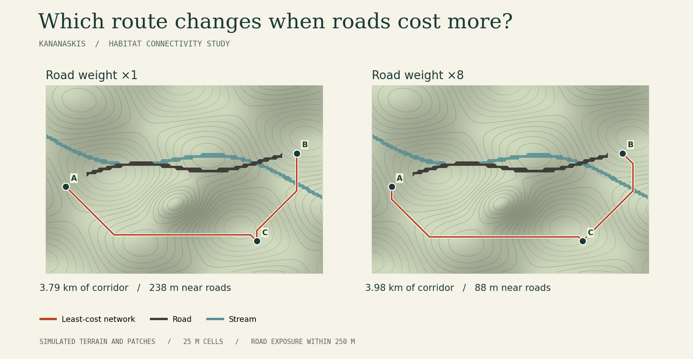

# Kananaskis · Habitat corridors

What happens to a habitat network when travelling near roads becomes more costly? In this reproducible example, increasing one weight from 1 to 8 cuts the length of the network within 250 m of a road **from 237.5 m to 88.4 m**, while the network grows by about 191 m.



[한국어](README.ko.md) · [Read the routing code](corridors.py) · [ArcGIS Pro workflow](arcpy_workflow.py) · [Measured results](examples/metrics.csv)

## From coursework to this experiment

My GEOS 456 GIS Programming final at SAIT connected bear habitat regions in Kananaskis Country, Alberta. I worked with a 25 m grid, a terrain ruggedness layer, proximity to water, roads and trails, a weighted cost surface and ArcGIS Pro's Optimal Region Connections tool. Land cover was also reclassified in the coursework. The four terms varied in the public code are explicit in the resistance function.

This release rebuilds the method in two ways. The portable example uses a generated landscape and three single-cell habitat patches. The ArcPy entry point accepts projected DEM, network features, region patches and a study boundary. Neither example is a map of an observed bear movement or a validated habitat model. The comparison figure and lengths come from the portable example.

## Reproduce the comparison

From this directory, use Python 3.9 or later.

```sh
python -m pip install -r requirements.txt
python corridors.py --road-weights 1 8 --output results
python -m unittest discover -s tests
```

The command writes a CSV with network metrics and a JSON file with the ordered cells of each connection. The two shipped outputs are in [examples](examples). Add another value after `--road-weights` to test another assumption.

| Road weight | Unique network length | Within 250 m of road |
| ---: | ---: | ---: |
| 1 | 3,791.0 m | 237.5 m |
| 8 | 3,982.4 m | 88.4 m |

## Where to look in the code

1. **`factors`** turns 3 × 3 terrain range and proximity measurements into four comparable terms. Terrain roughness and distance from water add cost. Proximity to roads and trails adds cost. The distance and height scales are teaching choices specified in the function.
2. **`resistance`** changes only the road coefficient. The positive base cost also charges for distance travelled.
3. **`shortest_paths` and `network`** find eight-neighbour least-cost paths, then select a minimum spanning tree of the pairwise connections. This transparent point-patch demonstration approximates the intent of the ArcGIS regional workflow.
4. **`edge_lengths`** counts shared segments once. For a segment crossing the 250 m threshold, the road-exposure estimate assigns half the segment length when one endpoint falls inside.

## Run with ArcGIS Pro

Use the ArcGIS Pro Python environment with Spatial Analyst. Supply your own metre-based layers in the same projected CRS, and a path to a new file geodatabase. DEM vertical units must be metres. Use polygon patches or an integer region raster and a boundary covering valid input features. Relative input paths are resolved before switching workspaces.

```sh
python arcpy_workflow.py --dem inputs/dem.tif --roads inputs/roads.shp --trails inputs/trails.shp --water inputs/streams.shp --patches inputs/habitat.shp --boundary inputs/study_area.shp --output results_w1.gdb --road-weight 1
```

Repeat with a different output name and weight. Outputs are a resistance raster and a corridor feature class. The portable solver was tested with the included example; the ArcPy entry point requires a local ArcGIS run. [Esri documentation on Optimal Region Connections](https://pro.arcgis.com/en/pro-app/latest/tool-reference/spatial-analyst/optimal-region-connections.htm)
